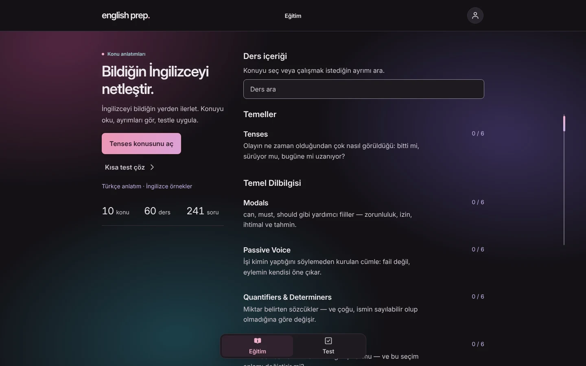

# English Prep

**Parked at v0.79 (October 2026): complete and working, not in active development.**

[Open the app](https://erendenizk.github.io/english-prep/) ·
[About](https://erendenizk.github.io/english-prep/about/)

## What it is

A study app for Turkish learners whose English ear is good but who were never taught the labels.
Every lesson is one "X vs Y" distinction (*Present Perfect vs Past Simple*, *must vs have to*): the
boundary the ear blurs, named and explained in Turkish with English examples. 10 topics, 60
lessons and 241 questions, with an explanation for every wrong option. No accounts: progress and
history stay in the browser's `localStorage`, and nothing leaves it.



## How it is built

Plain HTML, CSS and ES modules served by GitHub Pages: no build step and no runtime dependencies
(`package.json` holds tooling only). Lessons and questions are JSON in `data/`, validated by
`tools/validate-content.mjs`. Checks: 250+ unit tests (`node:test`), a Chromium sweep of about
3,600 checks at four widths, and 17 Python browser suites, all run in CI on `test`.

## Run and test

```bash
npm run serve      # static server on http://localhost:8000 (a file:// URL will not work)
npm run check      # formatting, content validation, colour contrast, unit tests
npm run verify     # Chromium sweep; needs the server running and Playwright
npm run browser    # every Python browser suite (see tests/README.md)
```

Python 3 serves the files and Node.js runs the tooling; there is no `npm install` step.

## Branches

- `test`: development and the live GitHub Pages site. A push is a deploy.
- `main`: the owner's release branch, moved by hand.

## Docs

- [`CLAUDE.md`](CLAUDE.md): rules and how to verify a change.
- [`docs/STATE.md`](docs/STATE.md): what the code does today and its weak spots.
- [`docs/ROADMAP.md`](docs/ROADMAP.md): the work left before V1, in order.
- [`docs/PRODUCT-DIRECTION.md`](docs/PRODUCT-DIRECTION.md): the open question of what the product becomes.
- [`docs/adr/`](docs/adr/): design decisions.
- [`docs/history/`](docs/history/): earlier plans, rounds and records; they explain, never bind.

All rights reserved unless a license is added.
